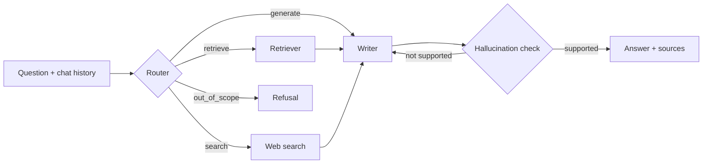

# SEC 10-K Research Assistant

A multi-agent RAG system that answers questions about Apple's fiscal 2024 Form 10-K. It decides how to answer each question: searching the filing, searching the live web, answering directly, or refusing questions that are out of scope. It checks its own answers against the filing before returning them.

Built with LangGraph, FastAPI, ChromaDB, and OpenAI.

## Results

Evaluated with [RAGAS](https://docs.ragas.io) on 51 questions covering financials, operations, risk factors, market risk, and governance:

| Metric | Before | After |
|---|---|---|
| Faithfulness | 0.899 | **0.962** |
| Answer relevancy | 0.852 | **0.908** |

The gains came from diagnosing individual retrieval failures. For example, the reranker was dropping a long chunk that held the answer near its end, and the 10-K page headers were matching any query that mentioned "10-K".

## How it works



**Router** (`agent10.py`): GPT-4o with structured output picks one of four routes. It also rewrites follow-up questions so they stand on their own; for example, "what about net income?" becomes "What was Apple's net income in fiscal 2024?".

**Retriever** (`retriever_agent.py`): hybrid search over 349 chunks of the filing.
- BM25 keyword search and OpenAI-embedding semantic search, merged and reranked by a cross-encoder (`ms-marco-MiniLM-L-6-v2`)
- The top BM25 and semantic hits are always kept, because the cross-encoder only reads the first 512 tokens of a chunk
- Page headers and phrases like "in its 2024 10-K" are ignored when scoring, since every chunk shares them
- If the best chunk scores below a threshold, the question is rewritten in 10-K terms and searched again. For example, "rev?" becomes "net sales".

**Web search** (`search_agent.py`): Tavily for live information such as today's stock price. It retries with backoff, and if search is down, the answer says it may be out of date.

**Writer** (`writer_agent.py`): writes the answer from the retrieved chunks, then an LLM check verifies the answer is supported by them. If not, it regenerates once, telling the model what was rejected. Answers that still fail are flagged as unverified in the UI.

**API** (`api.py`): FastAPI with input validation, error responses for rate limits, timeouts, and bad keys, and an exact-match response cache (`cache.py`) keyed on the data version.

## Example

> **You:** how much did they make from phones
> **Assistant:** Apple made $201,183 million from iPhone sales in fiscal year 2024.
>
> **You:** what about services?
> **Assistant:** Apple generated $96,169 million in revenue from Services in fiscal year 2024.
>
> **You:** write me a poem about pizza
> **Assistant:** I can only help with questions about Apple's fiscal 2024 Form 10-K…

## Running locally

Requires Python 3.11+.

```bash
python -m venv .venv
source .venv/bin/activate
pip install -r requirements.txt
```

Create a `.env` file in the project root (it's gitignored):

```
OPENAI_API_KEY=...
TAVILY_API_KEY=...
LANGFUSE_PUBLIC_KEY=...
LANGFUSE_SECRET_KEY=...
LANGFUSE_HOST=https://cloud.langfuse.com
```

Start the server and open http://127.0.0.1:8000:

```bash
uvicorn api:app --reload
```

Or chat in the terminal with `python agent10.py`.

### Ingesting the filing

The vector store lives in `data/vector_store` and isn't committed. To build it, put the 10-K PDF at `apple.pdf`, add `LLAMAPARSE_API_KEY` to `.env`, and run:

```bash
pip install llama-parse langchain-text-splitters
python ingest.py
```

## Testing

Offline tests mock every LLM, search, and retrieval call, so they're fast and free:

```bash
pip install pytest
python -m pytest tests -q
```

They cover routing and scope checks, the hallucination retry loop, query rewriting, search retries, caching, and every API error path.

The RAGAS evaluation calls the real models (it costs a few dollars in OpenAI usage) and fails if faithfulness drops below 0.90 or answer relevancy below 0.85:

```bash
python eval_ragas.py
```

## Limitations

- Only Apple's fiscal 2024 10-K is indexed (including the fiscal 2023 and 2022 comparison figures it reports). Multi-company support is planned.
- Some questions, such as audit fees, are answered in Apple's proxy statement rather than the 10-K, so the assistant says it can't find them.
- The response cache is in memory, so each server process has its own.
